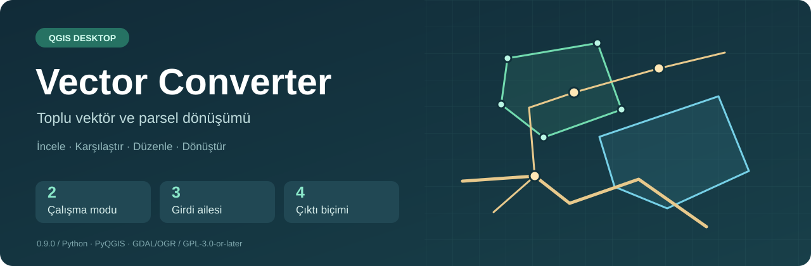
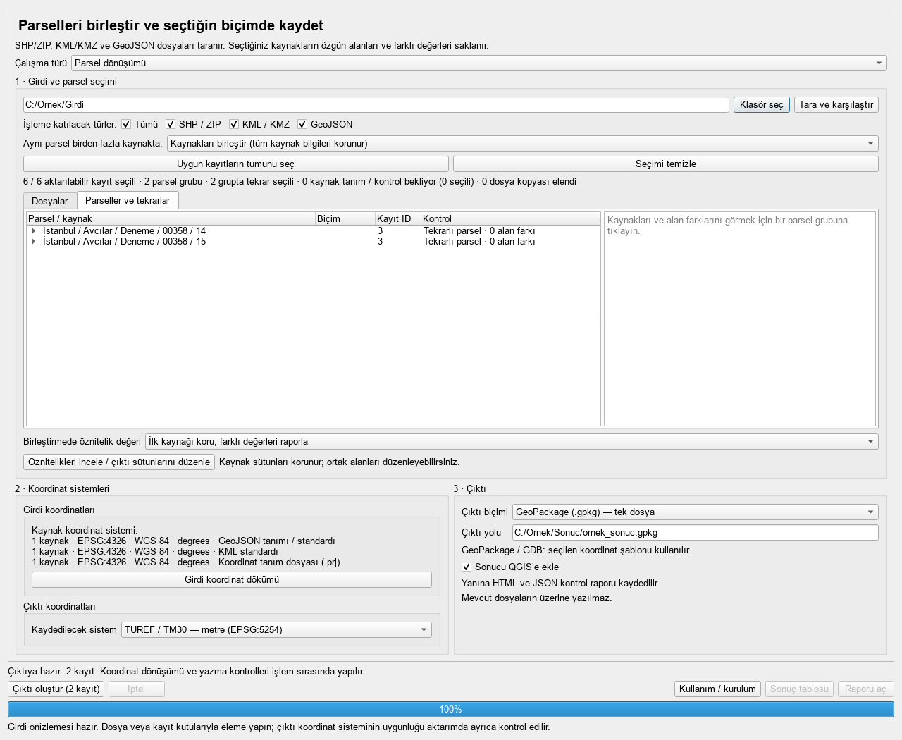
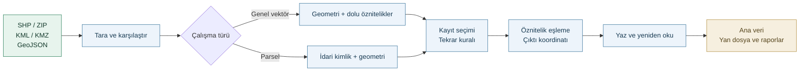
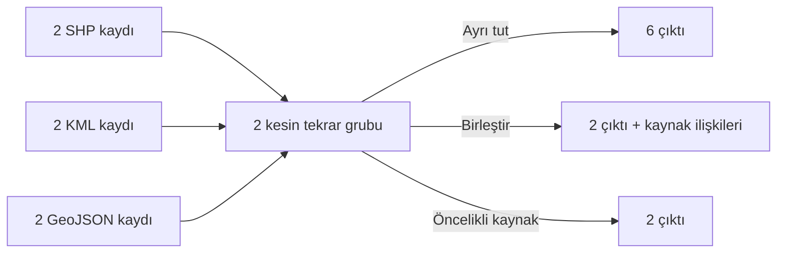
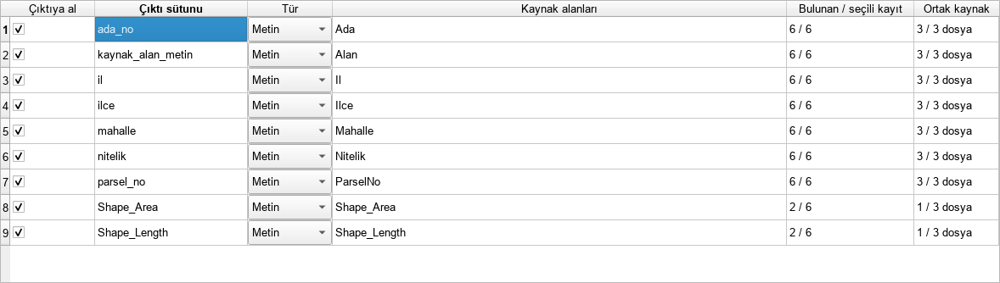
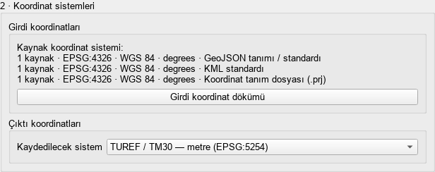
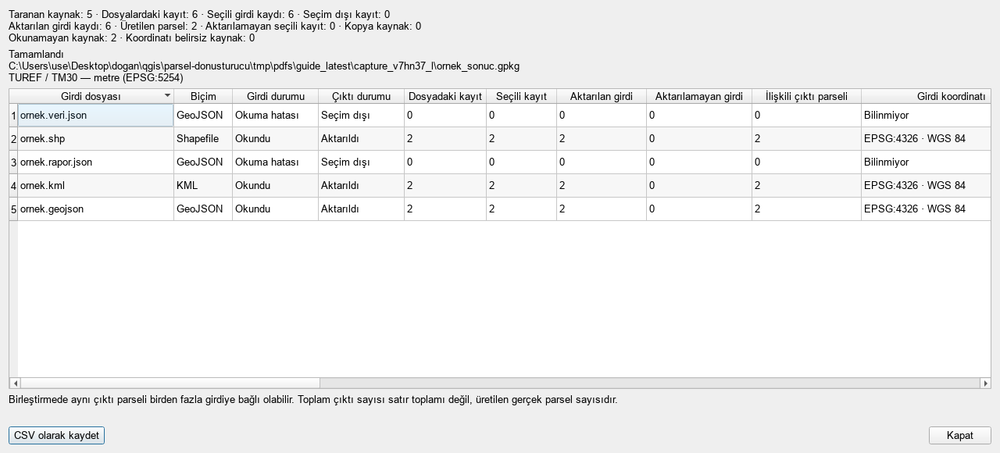
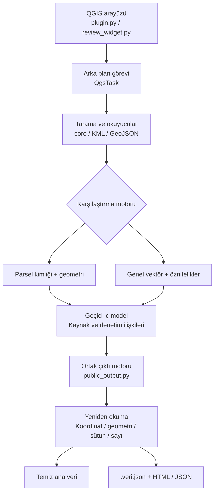

<p align="center">
  
</p>

<p align="center">
  <a href="https://github.com/dogandgn/vector-converter/releases/download/v0.9.0/parsel_donusturucu-0.9.0.zip"><strong>Kurulum ZIP’ini indir</strong></a> ·
  <a href="#kurulum">Kurulum</a> ·
  <a href="#veri-akışı">Veri akışı</a> ·
  <a href="docs/USAGE.en.md">English</a>
</p>

# Vector Converter

QGIS Desktop içinde **vektör ve parsel dosyalarını topluca inceleyen, karşılaştıran ve dönüştüren** eklenti. Bir klasördeki Shapefile, KML ve GeoJSON verilerini tarar; kayıt seçimini, tekrar yönetimini, öznitelik eşlemeyi ve toplu koordinat dönüşümünü tek akışta birleştirir.

QGIS menüsündeki eklenti adı **Parsel Dönüştürücü**dür. Genel vektör modunda parsel kimliği gerekmez; nokta, çizgi ve poligon verileri işlenebilir.

**English:** Batch review and conversion of 2D vector and parcel data in QGIS. Inspect sources, manage exact duplicates, map attributes and transform coordinates before exporting to GeoPackage, FileGDB, GeoJSON or KML. [Installation and usage in English →](docs/USAGE.en.md)

| Çalışma modları | Girdiler | Çıktılar | Doğrulanmış ortamlar |
| --- | --- | --- | --- |
| Genel vektör · Parsel dönüşümü | SHP / ZIP · KML / KMZ · GeoJSON | GPKG · GDB · GeoJSON · KML | Windows: QGIS 3.44.13 / Qt5 ve 4.2.1 / Qt6 |

## Özellikler

| İşlem | Eklentinin yaptığı |
| --- | --- |
| **Karma klasör taraması** | Farklı dosya türlerini aynı klasörden okur; biçim, kayıt sayısı, koordinat tanımı ve okuma durumunu gösterir. |
| **Kayıt ve kaynak seçimi** | Dosya türlerini ve tek tek kayıtları seçtirir. Tekrarlar çıktı oluşturulmadan önce görünür. |
| **Tekrar yönetimi** | Kayıtları ayrı tutar, kesin eşleşen kaynakları birleştirir veya biçim önceliğine göre tek kaynak seçer. |
| **Öznitelik düzenleme** | Ortak sütunları ve kaynaklarını listeler; çıktı sütunlarını seçme, adlandırma, eşleme ve tür belirleme sağlar. |
| **Koordinat dönüşümü** | Girdi sistemlerini salt okunur gösterir; seçilen çıktı sistemini bütün seçili kayıtlara uygular. |
| **Geometri ölçümleri** | Eksik Shape alanlarını poligon için m²/metre, çizgi için metre olarak üretir. |
| **Temiz ana veri** | Seçilen kaynak özniteliklerini korur. İşlem yöntemi, hedef sistem ve kontrol durumu gibi denetim sütunlarını ana katmana eklemez. |
| **KML gösterimi** | Parselleri idari kimlikle adlandırır; kayda tıklandığında öznitelik bilgi tablosu gösterir. |
| **Doğrulanmış çıktı** | Yazılan dosyayı yeniden açar; geometriyi, koordinatları, öznitelikleri ve kayıt sayısını denetler. |
| **İşlem raporu** | Girdi/çıktı karşılaştırması, toplamlar, HTML/JSON raporları ve isteğe bağlı CSV sağlar. |

## Kurulum

1. [**parsel_donusturucu-0.9.0.zip**](https://github.com/dogandgn/vector-converter/releases/download/v0.9.0/parsel_donusturucu-0.9.0.zip) dosyasını indirin.
2. QGIS → **Eklentiler → Eklentileri Yönet ve Yükle → ZIP’ten Yükle** yolunu açın.
3. İndirdiğiniz ZIP’i seçerek yükleyin.
4. **Vektör → Parsel Dönüştürücü** menüsünden eklentiyi açın.

**Releases → Assets** altındaki eklenti paketini kullanın. **Code → Download ZIP** ve **Source code** arşivleri kaynak kod içindir; doğrudan QGIS’e kurulmaz.

Gerekli Python, Qt ve GDAL/OGR bileşenleri QGIS’ten alınır. Ayrı Python kurulumu, ek modül veya çevrimiçi hesap gerekmez.

## Kullanım



*Görseldeki dosya yolları örnekleştirilmiştir. Altı sentetik kaynak kaydı iki parsel grubunu temsil eder.*

1. **Çalışma türü:** Genel vektör veya Parsel dönüşümü seçin. İlk açılışta klasör ve çıktı yolu boştur; alt bölümler çalışma türü seçilince etkinleşir.
2. **Klasör ve tarama:** Girdi klasörünü seçip **Tara ve karşılaştır** düğmesine basın.
3. **Seçim:** İşleme katılacak dosya türlerini, tekrar kuralını ve kayıtları belirleyin.
4. **Öznitelikler:** Gerekiyorsa **Öznitelikleri incele / çıktı sütunlarını düzenle** penceresinde ortak alanları ve çıktı şemasını düzenleyin.
5. **Koordinatlar:** Girdinin mevcut sistemini inceleyin; çıktı biçimi ve hedef koordinat sistemini seçin.
6. **Kayıt konumu:** **Çıktı yolu** alanına tıklayıp dosya adını ve yerini belirleyin.
7. **Çalıştır:** **Çıktı oluştur** düğmesine basın. Sonuç tablosunu ve raporu inceleyin; gerektiğinde CSV kaydedin.

Çıktı oluştur düğmesi etkin değilse altındaki hazırlık mesajı eksik seçimi veya sorunlu girdiyi belirtir. Çalışma türü değişirse önizleme ve sütun planı sıfırlanır; yeniden tarama gerekir.

## İki çalışma modu

| Davranış | Genel vektör | Parsel dönüşümü |
| --- | --- | --- |
| Geometri | Point / MultiPoint, LineString / MultiLineString, Polygon / MultiPolygon | Polygon / MultiPolygon |
| Kimlik | Parsel numarası gerekmez | İdari parsel kimliği okunur |
| Kesin tekrar | Aynı geometri ailesi, aynı geometri ve aynı dolu öznitelikler | Aynı parsel kimliği ve aynı yatay geometri |
| İnceleme önerisi | Geometri, alanlar, kayıtlar ve ad üzerinden katman benzerliği | Kimlik ve sınır farklılıkları |
| GPKG / GDB katmanları | Gerektiğinde `noktalar`, `cizgiler`, `poligonlar` | Tek `parseller` katmanı |
| KML kayıt adı | Mevcut ad, seçilen sütun veya katman/kayıt adı | İl / ilçe / mahalle - Ada …, Parsel … |

**Benzerlik, kesin tekrar değildir.** Yalnız aynı katman adı otomatik birleştirme için yeterli olmaz. Genel vektörde aynı geometride farklı veya eksik öznitelikler ayrı tutulur; boş öznitelikli kayıtlar otomatik tekilleştirilmez. Ters yönlü çizgiler otomatik tekrar sayılmaz. Yakınlık toleransı ve sınır eritme uygulanmaz.

## Veri akışı



### Seçim kuralları

| Seçenek | Sonuç |
| --- | --- |
| **Kayıtları ayrı tut** | Seçili kaynak kayıtları ayrı çıktı kayıtları olarak kalır. |
| **Kaynakları birleştir** | Kesin tekrar grubundan tek kayıt oluşur; seçili kaynak değerleri ve ilişkileri yan dosyada korunur. |
| **Önceliğe göre tek kaynak seç** | Her kesin tekrar grubunda ilk uygun tür seçilir. O tür yoksa sıradaki açık ve mevcut tür kullanılır. Benzersiz kayıtlar korunur. |

**Tümü** işaretliyken üç dosya türü de açıktır. Bir tür kaldırıldığında Tümü işareti kalkar. **Seçimi temizle** bütün kayıtları kapatır. **Önceliğe göre seç** veya **Uygun kayıtların tümünü seç**, seçimi baştan kurup elle yapılan elemeleri sıfırlar. Tür/öncelik sırasını değiştirmek ise elle yapılan elemeleri korur.

<details>
<summary><strong>Örnek: 6 girdi kaydından 2 çıktı</strong></summary>

İki parselin SHP, KML ve GeoJSON kopyaları toplam altı kaynak kaydıdır. Ayrı tutma altı, kesin tekrarları birleştirme iki, öncelikli tek kaynak seçimi yine iki çıktı üretir. Aynı klasörde yalnız bir biçimde bulunan başka bir kayıt da korunur.



</details>

## Öznitelikler ve ölçümler

<details>
<summary><strong>Öznitelik tablosu ve düzenleme ayrıntıları</strong></summary>



- Seçili kaynakların ortak sütunları, türleri, bulunma durumları ve örnek değerleri incelenir.
- Sütun seçimi, yeniden adlandırma ve farklı kaynak adlarını tek çıktı sütununda eşleme yapılabilir.
- Birleşik şemada eksik değer `NULL` kalabilir. Kaynak dosyaya sütun eklenmez veya kaynak sütun silinmez.
- Aynı birleştirilen kaydın seçili kaynakları arasında değer tamamlama yapılabilir. İlgisiz kayıtların değerleri kopyalanmaz.
- `NULL` ve boş metin aynı değildir. `001`, `1` ve `1.0` özellikle genel vektör karşılaştırmasında varsayımla eşitlenmez.
- Uyumsuz türler, mantıksal/iç içe değerler ve 32 bit sınırını aşan sayılar taşınabilir şemada metin olabilir; özgün türler `.veri.json` dosyasında tutulur.

</details>

Ana veri yalnız seçilen kaynak özniteliklerini ve gerekli geometri ölçümlerini içerir. Eklenti kayıt kimliği, kaynak sayısı, yöntem, hedef sistem, kontrol durumu veya alan farkı gibi işlem sütunları eklemez. Sürücünün zorunlu `fid` / `OBJECTID` ve geometri sütunu sistem alanlarıdır.

| Geometri | Eksikse üretilen sütun | Birim |
| --- | --- | --- |
| Poligon / MultiPolygon | `Shape_Area`, `Shape_Length` | m², metre |
| Çizgi / MultiLineString | `Shape_Length` | metre |
| Nokta / MultiPoint | Ölçüm sütunu eklenmez | — |

Derece koordinatlı çıktıda yeni ölçümler çıktı sisteminin **elipsoidi üzerinde** hesaplanır; derece², m² diye yazılmaz. Metre koordinatlı çıktıda düzlemsel hesap kullanılır. FileGDB’de yeni ölçümler kaydedilen ızgara geometrisinden hesaplanır.

Kaynakta aynı adlı Shape sütunları varsa mevcut değerler korunur; otomatik yeniden hesaplanmaz. Bu sütunların birimini kaynak veri belirler. Hesaplanan geometri alanı ile resmî parsel alanı aynı kavram değildir.

## Koordinat sistemleri



Girdi sistemleri veriden okunarak listelenir; bu bölümde sistem atama veya değiştirme yapılmaz. Çıktı listesi veriden okunan sistemleri ve hazır hedefleri ayrı başlıklarda gösterir. Kullanıcı yalnız çıktı sistemini seçer.

| Hazır aile | Seçenekler |
| --- | --- |
| Derece | WGS84 (4326), TUREF (5252), ED50 (4230) |
| TUREF / 3° TM | TM27–TM45, 3° aralıklarla; EPSG 5253–5259 |
| ED50 / 3° TM | TM27–TM45, 3° aralıklarla; EPSG 2319–2325 |
| WGS84 / UTM | 35N–38N; EPSG 32635–32638 |
| ED50 / UTM | 35N–38N; EPSG 23035–23038 |

Toplam **25 hazır şablon** bulunur. EPSG, koordinat sisteminin kayıt kodudur. Dilim veri konumuna göre seçilir. TUREF, ITRF96 ile 2005.0 referans epoğunda ilişkilidir; farklı sürüm veya gözlem yılları arasında hız/epok dönüşümü yapılmaz. Şablon düzenleme ekranı yoktur.

**KML / GeoJSON çıktısı WGS84 derece kullanır**; hedef seçiminin pasif olması biçim kuralındandır. Diğer hedefler için GeoPackage veya FileGDB seçilir.

<details>
<summary><strong>Koordinat tanımı olmayan Shapefile girdisi</strong></summary>

`.prj`, Shapefile’ın koordinat tanım dosyasıdır. Parsel modunda tanımsız SHP’nin bütün kayıtları geçerli eş KML/GeoJSON ile tam parsel kimliği ve birebir yatay sınır koordinatlarında eşleşirse WGS84 kaynak dayanağı çıkarılabilir. Dayanak listede/raporda görünür; kaynak dosyaya tanım yazılmaz.

Kısmi/çelişkili eşleşme, aynı numara veya koordinat aralığı yeterli değildir. Genel vektörde eş dosyadan sistem tahmini yapılmaz. Tanım tamamlanmalı veya ilgili girdi seçimden çıkarılmalıdır. Çıktı sistemini seçmek bilinmeyen kaynak sistemini çözmez.

</details>

## Çıktılar ve raporlar

| Çıktı | Yapı | Koordinat |
| --- | --- | --- |
| **GeoPackage `.gpkg`** | Tek SQLite tabanlı dosya; geometri ailelerine göre katmanlar | Seçilen şablon |
| **FileGDB `.gdb`** | Klasör veritabanı; Windows ve OpenFileGDB yazma desteği gerekir | Seçilen şablon |
| **GeoJSON `.geojson`** | Tek FeatureCollection; genel modda karma geometri olabilir | WGS84 derece |
| **KML `.kml`** | Kayıt adları, öznitelik bilgi tablosu ve tipli veri; genel modda geometri klasörleri | WGS84 derece |

```text
sonuc.gpkg         Ana mekânsal veri
sonuc.veri.json    Özgün tür/değerler ve kaynak ilişkileri
sonuc.rapor.html   Okunabilir işlem raporu
sonuc.rapor.json   Makine tarafından okunabilir rapor
```

Ana GPKG/GDB’de işlem veya izleme tabloları bulunmaz. CSV, girdi/sonuç penceresinden istenirse kaydedilir; UTF-8 ve noktalı virgül ayırıcı kullanır, toplam satırı içerir.

<details>
<summary><strong>Sonuç karşılaştırması</strong></summary>



Girdi dökümü kaynak sistemlerini ve kayıt durumlarını gösterir. Sonuç tablosu seçim dışı, aktarılan ve aktarılamayan girdileri, ilişkili çıktıları ve hedef sistemleri karşılaştırır. Bir çıktı birden çok girdiye bağlı olabilir; gerçek toplam çıktı sayısı ayrıca gösterilir. Sonradan seçim değiştirmek tamamlanmış işlemin tablosunu değiştirmez.

</details>

### KML adları ve bilgi tablosu

Parsel kayıtları **il / ilçe / mahalle - Ada …, Parsel …** biçiminde görünür; her kayıt için ayrı katman oluşturulmaz. Genel vektör mevcut KML adını veya kaynak ad alanını kullanır. **Genel vektör + KML** seçiliyken kayıt adı için başka bir çıktı sütunu seçilebilir.

Tıklama tablosu **HTML metnidir, resim değildir**. Öznitelikler ayrıca `SchemaData/SimpleData` içinde gerçek veri olarak saklanır ve QGIS’te başka biçime aktarılabilir. KML okuyucuları standart `Name`, `description` ve diğer sunum alanlarını gösterebilir; bunlar ana ExtendedData’ya eklenen işlem sütunları değildir.

## Teknik mimari



<details>
<summary><strong>Modüller ve çalışma bileşenleri</strong></summary>

| Bileşen | Görev | Kaynak |
| --- | --- | --- |
| Arayüz / görev | QGIS menüsü, pencere, ilerleme ve iptal | [`plugin.py`](parsel_donusturucu/plugin.py) |
| Kayıt seçimi | Tür filtresi, dosya ve tekrar grubu seçimi | [`review_widget.py`](parsel_donusturucu/review_widget.py) |
| Öznitelik şeması | Envanter, tür, ad ve değer eşleme | [`attribute_schema.py`](parsel_donusturucu/attribute_schema.py) |
| Kaynak koordinatı | Okunan tanım ve sınırlı parsel eş dosya dayanağı | [`source_crs.py`](parsel_donusturucu/source_crs.py) |
| Genel vektör | Kesin tekrar, benzerlik ve iç model | [`vector_review.py`](parsel_donusturucu/vector_review.py), [`vector_export.py`](parsel_donusturucu/vector_export.py) |
| Ana çıktı | Temiz sütunlar, ölçümler, biçim yazımı, doğrulama | [`public_output.py`](parsel_donusturucu/public_output.py) |
| Karşılaştırma | Durumlar, toplamlar ve CSV | [`comparison.py`](parsel_donusturucu/comparison.py) |

Eklenti **Python / PyQGIS / qgis.PyQt / GDAL/OGR** kullanır. SQLite iç modeli; JSON, XML ve HTML veri/rapor biçimlerini taşır. Koordinat operasyonları QGIS’in PROJ altyapısından alınır. Kullanıcı verisi kurulum klasörüne yazılmaz.

</details>

## Uyumluluk ve doğrulama

- Gereksinimler: **QGIS Desktop 3.34–4.x**, Python 3.9+, GDAL 3.6+.
- Gerçekten denenen ortamlar: **Windows QGIS 3.44.13 / Qt5** ve **4.2.1 / Qt6**.
- FileGDB yazımı: **Windows + OpenFileGDB yazma desteği**.
- İki ortamda toplam **304 çalışma kontrolü**: her ortamda 152 kontrol. Temiz ZIP kurulumu, dört çıktı, iki mod, koordinatların korunması, geometri, ölçümler, öznitelikler, CSV, iptal ve XML kontrolleri dahildir.
- Diğer sürüm ve işletim sistemi birleşimleri doğrulanmış sayılmaz.

[Doğrulama kapsamı](docs/verification.md) · [Sayısal test özeti](docs/verification.json) · [Koordinat regresyon testleri](tests/test_coordinate_roundtrip.py)

### Biçim ve kapsam sınırları

Girdiler SHP/ZIP, KML/KMZ ve GeoJSON’dur. GPKG/GDB girdisi ve Shapefile çıktısı yoktur. Shapefile bileşenlerini birlikte tutun: `.shp`, `.shx`, `.dbf` ve varsa koordinat tanımı `.prj`, kodlama bilgisi `.cpg`. KMZ tek KML içermelidir.

Gerçek Z/M, karma GeometryCollection, dinamik epok dönüşümü, toleransla yakın kayıt birleştirme ve otomatik geometri onarma desteklenmez. Yeni alan/uzunluk hesapları, girdinin saha veya kadastro doğruluğunu belgelemez.

## Belgeler ve destek

- [English installation and usage](docs/USAGE.en.md)
- [0.9.0 indirme dosyaları](https://github.com/dogandgn/vector-converter/releases/tag/v0.9.0)
- [Hata bildirimleri](https://github.com/dogandgn/vector-converter/issues)

**Lisans:** [GPL-3.0-or-later](LICENSE).

**Geliştirici sitesi:** [doganaric.com](https://doganaric.com)
